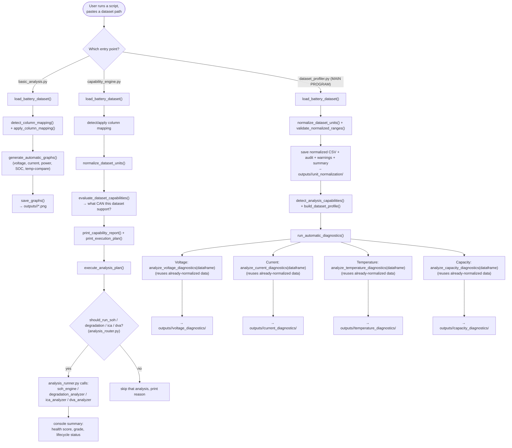

# Battery Intelligence Platform — Architecture & Flow Report

Generated by reading every `.py` file under `battery_intelligence_platform/`,
tracing every `import`, and checking which functions/files are ever reached
from the three real entry points.

> **Update:** the dead code originally found here (`unit_normalizer_backup.py`
> and a duplicate `calculate_capacity_soh` function in `soh_engine.py`) has
> since been deleted from the project. The duplicated-logic issue (temperature
> and capacity diagnostics re-reading the file from disk with their own private
> column-mapping copy) has also been fixed — both now reuse
> `core/file_reader.py` / `core/column_mapper.py` and accept the
> already-normalized in-memory data, exactly like voltage and current
> diagnostics. Only the orphaned-code note remains, since that is still
> present.

---

## 1. Reading order — open these files in this sequence

The file Explorer sorts alphabetically, which has nothing to do with execution
order. If you (or anyone new to this project) want to read the source files
in the actual order they run, pick the entry point you care about and follow
its numbered list top to bottom.

### A. `dataset_profiler.py` — the full pipeline (recommended starting point)

This is the one that produced `outputs/unit_conversion_test/`'s 5 subfolders.

1. `core/dataset_profiler.py` — start here, this is the script you run
2. `core/file_reader.py` — loads the dataset file
3. `core/column_mapper.py` — maps messy column names to standard ones
4. `core/unit_normalizer.py` — converts units, saves the normalized CSV
5. *(back in `dataset_profiler.py`)* — checks which diagnostics are possible
6. `analytics/diagnostics/voltage_diagnostics.py`
7. `analytics/diagnostics/current_diagnostics.py`
8. `analytics/diagnostics/temperature_diagnostics.py`
9. `analytics/diagnostics/capacity_diagnostics.py`

Steps 6–9 all run independently off the same normalized data from step 4 —
none of them depend on each other, so the order among them doesn't matter.

### B. `capability_engine.py` — SOH/degradation/ICA/DVA path

1. `core/capability_engine.py` — start here
2. `core/file_reader.py`
3. `core/column_mapper.py`
4. `core/unit_normalizer.py`
5. *(back in `capability_engine.py`)* — builds the capability report
6. `core/execution_engine.py` — decides what to run
7. `core/analysis_router.py` — pure yes/no gatekeeping
8. `core/analysis_runner.py` — dispatches to whichever of these apply:
   - `analytics/soh_engine.py`
   - `analytics/degradation_analyzer.py`
   - `analytics/ica_dva/ica_analyzer.py`
   - `analytics/ica_dva/dva_analyzer.py`

### C. `basic_analysis.py` — quick charts only

1. `analytics/basic_analysis.py` — start here
2. `core/file_reader.py`
3. `core/column_mapper.py`

(No `unit_normalizer.py` step in this path — charts are drawn from
column-mapped but not unit-converted data.)

### Not part of any reading order above

These files are complete and runnable on their own, but no entry point ever
calls them — see §4 for details: `core/cycle_feature_adapter.py`,
`analytics/soc/soc_estimator.py`, `analytics/soc/soc_capability_checker.py`,
`analytics/ica_dva/ica_dva_capability_checker.py`.

---

## 2. Block Diagram (components + who imports whom)

Color key: 🟡 yellow = **orphaned** (works standalone, but no pipeline calls
it).

```mermaid
flowchart TD

    subgraph ENTRY["ENTRY POINTS — 3 separate CLI scripts, none call each other"]
        BA["basic_analysis.py"]
        CE["capability_engine.py"]
        DP["dataset_profiler.py<br/>('MAIN PROGRAM')"]
    end

    subgraph CORE["core/"]
        FR["file_reader.py"]
        CM["column_mapper.py"]
        UN["unit_normalizer.py"]
        EE["execution_engine.py"]
        AR["analysis_router.py"]
        ARUN["analysis_runner.py"]
        CFA["cycle_feature_adapter.py"]
    end

    subgraph DIAG["analytics/diagnostics/"]
        VD["voltage_diagnostics.py"]
        CD["current_diagnostics.py"]
        TD["temperature_diagnostics.py"]
        CAD["capacity_diagnostics.py"]
    end

    subgraph SOC["analytics/soc/"]
        SE["soc_estimator.py"]
        SCC["soc_capability_checker.py"]
    end

    subgraph ICADVA["analytics/ica_dva/"]
        IA["ica_analyzer.py"]
        DA["dva_analyzer.py"]
        IDC["ica_dva_capability_checker.py"]
    end

    subgraph OTHERA["analytics/ (other)"]
        SOH["soh_engine.py"]
        DEG["degradation_analyzer.py"]
    end

    DATA[("saved_column_mappings.json")]

    BA --> FR
    BA --> CM

    CE --> FR
    CE --> CM
    CE --> UN
    CE --> EE
    EE --> AR
    EE --> ARUN
    ARUN --> IA
    ARUN --> DA
    ARUN --> SOH
    ARUN --> DEG

    DP --> FR
    DP --> CM
    DP --> UN
    DP --> VD
    DP --> CD
    DP --> TD
    DP --> CAD

    VD --> FR
    VD --> CM
    CD --> FR
    CD --> CM
    TD --> FR
    TD --> CM
    CAD --> FR
    CAD --> CM
    IA --> FR
    IA --> CM
    DA --> FR
    DA --> CM
    SOH --> FR
    SOH --> CM
    SE --> FR
    SE --> CM
    SCC --> FR
    SCC --> CM
    IDC --> FR
    IDC --> CM
    CFA --> FR

    CM --> DATA

    class CFA,SE,SCC,IDC orphan

    classDef orphan fill:#fff3cd,stroke:#cc9900,stroke-width:2px,color:#664d00
```

---

## 3. Flow Diagram (what actually happens when you run each entry point)

**This is exactly how `outputs/unit_conversion_test/` got its 5 subfolders** — that
was produced by `dataset_profiler.py`, the only script that bundles unit
normalization + all four diagnostics into one run.

---

## 4. Orphaned code — not dead, but not wired into any pipeline

These files are fully implemented and runnable on their own (each has its own
`if __name__ == "__main__":`), but **none of the three entry points
(`basic_analysis.py`, `capability_engine.py`, `dataset_profiler.py`) ever
import or call them.** They only run if someone manually executes that exact
file.

- `core/cycle_feature_adapter.py` — cycle-life dataset schema detector/adapter
- `analytics/soc/soc_estimator.py` — coulomb-counting SOC estimator
- `analytics/soc/soc_capability_checker.py` — checks if SOC estimation is feasible
- `analytics/ica_dva/ica_dva_capability_checker.py` — checks if ICA/DVA is feasible before running them

## 5. One-liner reference: what each block does, input → output

### Entry points

| File | What it does | Input | Output |
|---|---|---|---|
| `basic_analysis.py` | Generates a quick set of overview charts for any battery dataset | Dataset file path (typed at prompt) | `outputs/<name>/` folder with up to 6 PNGs (voltage, current, power, SOC%, temperature, ambient-temp comparison) |
| `capability_engine.py` | Figures out which advanced analyses (SOH/Degradation/ICA/DVA) a dataset supports, then runs only those | Dataset file path (typed at prompt) | Console capability report + execution plan + health/grade/lifecycle summary |
| `dataset_profiler.py` | The real "run everything" pipeline: normalizes units and runs all 4 diagnostics in one go | Dataset file path (typed at prompt) | `outputs/<name>/` folder with `unit_normalization/`, `voltage_diagnostics/`, `current_diagnostics/`, `temperature_diagnostics/`, `capacity_diagnostics/` |

### core/

| File | What it does | Input | Output |
|---|---|---|---|
| `file_reader.py` | Loads a dataset file safely, validating it exists and isn't empty | File path (.csv/.xlsx/.xls) | pandas DataFrame |
| `column_mapper.py` | Maps messy/inconsistent column names (e.g. `battery_voltage`, `voltage_mV`) to one standard name per measurement | Raw DataFrame | Column-mapping dict + standardized DataFrame + list of unrecognized columns |
| `unit_normalizer.py` | Converts each recognized column's unit to a standard unit (mV→V, mA→A, mAh→Ah, min→s, K→°C) | Standardized DataFrame | Normalized DataFrame + conversion audit + warnings + summary |
| `capability_engine.py` (core functions) | Checks which analyses are possible given the columns present | Normalized DataFrame | Capability report dict (available vs. unavailable analyses + reasons) |
| `execution_engine.py` | Runs whichever analyses the capability report says are possible, and prints the final intelligence summary | Capability report + normalized DataFrame | Console summary (health score, grade A–F, lifecycle status) |
| `analysis_router.py` | Pure yes/no gatekeeping logic for each analysis type | Capability report | Booleans (`should_run_soh`, etc.) / list of analysis names |
| `analysis_runner.py` | Thin dispatcher that calls the real analyzer modules and plots results | Normalized DataFrame | Calls into `soh_engine`, `degradation_analyzer`, `ica_analyzer`, `dva_analyzer` |
| `cycle_feature_adapter.py` 🟡 | Detects "cycle-life" style datasets and derives per-cycle features from them | Dataset file path (standalone only) | Adapted dataset + consistency report (not wired into the main pipeline) |
| `saved_column_mappings.json` | Stores manually-confirmed column-name decisions so you aren't asked again | — (data file) | Read/written by `column_mapper.py` |

### analytics/diagnostics/

| File | What it does | Input | Output |
|---|---|---|---|
| `voltage_diagnostics.py` | Checks per-cycle voltage range/safety against thresholds | Normalized DataFrame | Summary, cycle summary, detailed records, warnings CSVs + chart |
| `current_diagnostics.py` | Checks current draw patterns, spikes, sign convention, stability | Normalized DataFrame | Same CSV/chart pattern for current |
| `temperature_diagnostics.py` | Checks per-cycle temperature range/rise and risk classification | Normalized DataFrame | Same CSV/chart pattern for temperature |
| `capacity_diagnostics.py` | Tracks capacity fade per cycle, retention %, abnormal drops | Normalized DataFrame | Same CSV/chart pattern for capacity |

### analytics/soc/

| File | What it does | Input | Output |
|---|---|---|---|
| `soc_estimator.py` 🟡 | Estimates State of Charge via coulomb counting when no SOC column exists | Dataset file path (standalone only) | SOC results CSV + chart |
| `soc_capability_checker.py` 🟡 | Checks signal quality to decide if SOC estimation is even feasible | Dataset file path (standalone only) | Console capability report only |

### analytics/ica_dva/

| File | What it does | Input | Output |
|---|---|---|---|
| `ica_analyzer.py` | Computes Incremental Capacity Analysis (dQ/dV) curves per cycle | Normalized DataFrame | ICA results CSV + chart |
| `dva_analyzer.py` | Computes Differential Voltage Analysis (dV/dQ) curves per cycle | Normalized DataFrame | DVA results CSV + chart |
| `ica_dva_capability_checker.py` 🟡 | Pre-checks if discharge data is clean enough for ICA/DVA | Dataset file path (standalone only) | Console capability report only |

### analytics/ (other)

| File | What it does | Input | Output |
|---|---|---|---|
| `soh_engine.py` | Calculates per-cycle State of Health % from capacity fade and assigns a health category | Normalized DataFrame | SOH results CSV + chart |
| `degradation_analyzer.py` | Computes cycle-by-cycle capacity degradation metrics | Normalized DataFrame | Degradation results CSV + chart |

---

*Saved as `battery_intelligence_platform/ARCHITECTURE.md`. Open it in VS Code
with the Markdown Preview (Mermaid renders automatically) to see the diagrams
visually.*
